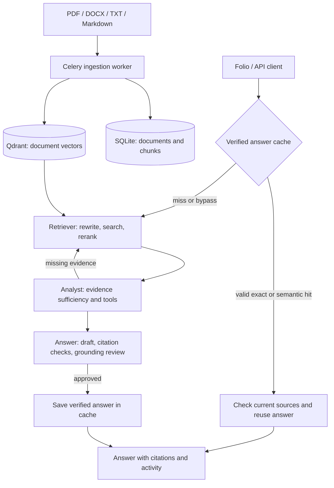

# NLP Doc Agent — Folio

**Folio** is a local document research workspace built around three agent roles:
**Retriever → Analyst → Answer**. Upload documents, ask questions, inspect the
supporting passages, and follow the actual processing steps in the browser.

The backend combines hybrid retrieval, deterministic analysis tools, grounded
answer generation, provider fallback, and verified-answer caching. The frontend
uses Next.js, React, and TypeScript; the backend uses FastAPI and Python.

## Features

- **Document ingestion:** PDF, DOCX, TXT, and Markdown, with background indexing,
  job status, duplicate-upload detection, reindexing, and deletion.
- **PDF extraction:** scientific text, source locations, structured tables, and
  aligned-layout fallback for partially ruled tables. Adjacent captions stay
  with their tables.
- **Retrieval:** local BGE embeddings plus BM25, Qdrant hybrid search, metadata
  filters, cross-encoder reranking, and context selection within a token budget.
- **Analysis tools:** source-backed calculator, table extraction, document
  comparison, and statistical analysis. Missing evidence drives bounded retrieval
  retries rather than unsupported answers.
- **Grounding:** structured responses, exact source excerpts, citation checks,
  explicit word-limit checks, and a separate LLM grounding review.
- **Live activity:** server-sent events show processing progress, repeated steps,
  provider waits, and the tools actually used. The final answer appears after review.
- **Provider fallback:** Groq models first, then optional OpenRouter models when
  Groq is rate limited. The example configuration uses free OpenRouter routing.
- **Answer caching:** Redis exact matches and guarded Qdrant semantic matches,
  current-source validation, expiration, and duplicate-request coordination.
- **Workspace:** document selection, source excerpts, tool outputs, cache-status
  badges, saved conversations, Markdown export, and light/dark themes.

## Architecture



The orchestrator is a bounded Python state machine. Verification is part of the
Answer role, although the activity UI displays it as a separate visible stage.
The grounding review is a separate model call; deterministic citation checks are
not. Three agent roles do not imply a fixed number of model calls.

| Component                  | Responsibility                                                          |
| -------------------------- | ----------------------------------------------------------------------- |
| Next.js frontend           | Browser workspace and same-origin backend proxy                         |
| FastAPI backend            | Chat, retrieval, analysis, verification, cache coordination             |
| Celery worker              | Parsing, cleaning, chunking, embedding, indexing                        |
| SQLite                     | Document metadata, chunks, jobs, and backend conversation records       |
| Qdrant                     | Document vectors and a separate semantic-cache pointer collection       |
| Redis                      | Celery broker/results, exact answer entries, and renewable query leases |
| Groq / optional OpenRouter | Remote language-model inference                                         |

## Quick start

### Prerequisites

- Docker Engine/Desktop with Docker Compose v2; use Linux containers.
- Internet access for initial image/model downloads and remote LLM requests.
- A Groq API key. OpenRouter is optional and requires its own key.
- For development outside Docker: Python **3.12**, `uv`, and Node.js **22+**.
- For CUDA: a compatible NVIDIA GPU and Docker GPU support. On Windows, use
  Docker Desktop with WSL2 GPU support.

Run Compose commands below from the repository root. Explicit `-f` arguments
avoid automatically loading the development override.

### 1. Configure the backend

Create a root `.env` file if it does not exist. Preserve your existing keys and
settings when updating an installation. A minimal configuration is:

```dotenv
GROQ_API_KEY=replace-with-your-groq-key
LLM_MODEL=openai/gpt-oss-120b
LLM_FALLBACK_MODELS=["openai/gpt-oss-20b","qwen/qwen3.8-27b"]

# Optional: tried after all configured Groq models are rate limited.
OPENROUTER_API_KEY=
OPENROUTER_FALLBACK_MODELS=["openrouter/free"]

QDRANT_URL=http://qdrant:6333
REDIS_URL=redis://redis:6379/0
DATABASE_URL=sqlite+aiosqlite:///./data/app.db
DATA_DIR=/app/data

EMBEDDING_MODEL=BAAI/bge-small-en-v1.5
RERANKER_MODEL=BAAI/bge-reranker-base
EMBEDDING_BATCH_SIZE=4
RERANKER_BATCH_SIZE=4
LOG_LEVEL=info
```

Use JSON arrays for model lists. `OPENROUTER_FALLBACK_MODELS=[]` or a missing
OpenRouter key disables that provider. Available models and quotas depend on the
provider/account; the example does not promise permanent model availability.

Keep provider keys on the backend. Never commit `.env` or expose keys through
`NEXT_PUBLIC_*` variables. The frontend uses server-only `BACKEND_URL`, configured
by Compose as `http://backend:8000`.

### 2. Start on CPU

```sh
docker compose -f docker-compose.yml up -d --build qdrant redis migrate backend worker frontend
```

### Or start with NVIDIA CUDA

```sh
docker compose -f docker-compose.yml -f docker-compose.gpu.yml up -d --build qdrant redis migrate backend worker frontend
```

The GPU override defaults embeddings and reranking to CUDA and shares a model
cache. If an existing `.env` sets `EMBEDDING_DEVICE=cpu` or
`RERANKER_DEVICE=cpu`, remove those overrides or change them to `cuda` to use the
GPU. For limited VRAM, reduce the batch sizes; the GPU worker uses one process.

PDF parsing, BM25, databases, and web services remain on CPU. Groq/OpenRouter
inference runs remotely; local CUDA does not increase their quotas.

### 3. Open and check the application

| Service           | Local URL                         |
| ----------------- | --------------------------------- |
| Folio             | <http://localhost:3000>           |
| API documentation | <http://localhost:8000/docs>      |
| Dependency health | <http://localhost:8000/health>    |
| Qdrant dashboard  | <http://localhost:6333/dashboard> |

The migration service upgrades SQLite before the API and worker start. Initial
startup can take longer while local models download and load. Health reports
SQLite, Redis, and Qdrant connectivity; it does not validate LLM credentials or quota.

If only the frontend needs to be added to an existing backend:

```sh
docker compose -f docker-compose.yml up -d --build --no-deps frontend
```

## Using Folio

1. Upload a supported document. The default maximum is **50 MiB per file**.
2. Wait for indexing to finish. New documents cannot be queried before they are ready.
3. Choose the documents to search, or use the default scope. An explicit empty
   selection never silently expands to all documents.
4. Ask a question. Filenames and supported page/chapter/section constraints can
   narrow the request further; they cannot widen an explicit document selection.
5. Follow the live activity, then inspect citations, source excerpts, tool results,
   and cache status on the completed response.

Standalone questions avoid an unnecessary LLM rewrite. Follow-ups use bounded
conversation history to resolve context. The backend supports up to three
retrieval rounds and three answer/review attempts. Invalid structured output has
bounded correction attempts; source validation is not relaxed during correction.

The Analyst decides whether evidence is sufficient and executes deterministic
tools when needed. The Answer Agent selects source excerpt IDs; the backend
copies their quotes verbatim. A separate review checks factual support, retained
qualifications, and unsupported additions before an answer is accepted.

Conversation messages are persisted in SQLite, while the browser stores the
workspace's conversation list and UI state. Browser history is not synchronized
between devices; the backend currently has no conversation-list endpoint.

## Verified-answer caching

Lookup order is **exact cache → eligible semantic cache → normal processing**.
Only successful, reviewed answers are stored. Errors and insufficient-evidence
responses are not cached as successful answers.

| Badge / `cache.status`                | Meaning                                                     |
| ------------------------------------- | ----------------------------------------------------------- |
| Cache miss / `miss`                   | No reusable answer was found; normal processing ran.        |
| Cache hit · Exact / `exact_hit`       | A verified answer matched the question and request scope.   |
| Cache hit · Semantic / `semantic_hit` | A guarded paraphrase matched an approved answer.            |
| Cache bypassed / `bypass`             | Caching was disabled or unavailable; normal processing ran. |

Exact keys preserve case, punctuation, and internal whitespace, trimming only the
outside of the question. Scope includes effective filters, the bounded history,
the corpus fingerprint, and backend/model version information.

Semantic matching is deliberately narrow. For standalone questions beginning with
`What is`, `What are`, `Explain`, `Describe`, `Define`, or `Tell me about`, the
remaining ordered, case-sensitive subject and constraints must match after removing final
question/period punctuation. Quoted or multiline requests are ineligible, and
requests with conversation history use exact matching only. Eligible candidates
also require cosine similarity of at least **0.94**. Arbitrary similar wording is
not sufficient, and many valid paraphrases intentionally miss.

For example, after a verified answer has been cached for:

```text
What is scaled dot-product attention?
```

this request is eligible for semantic reuse:

```text
Explain scaled dot-product attention.
```

Use fresh conversations, the same document selection, and unchanged documents
when testing. Changing `median latency` to `P95 latency` requests a different fact
and must not reuse the old answer merely because most words are identical.

Redis holds the answer; the separate `verified_answers_v1` Qdrant collection holds
embeddings and lookup pointers. Hits check current source metadata/quotes and
reuse the original grounding approval without a fresh LLM review. Consequently,
an answer-cache hit makes **zero model-provider requests**. Provider-reported
`cached_input_tokens` is a different mechanism and does not prove an answer hit.

Document additions, changes, deletions, and reindexing invalidate old scopes.
Invalidated entries become unreachable and expire by TTL; they are not all erased
immediately. Identical concurrent requests share a renewable Redis lease. If the
wait budget expires, `ANSWER_IN_PROGRESS` prevents a duplicate generation.

| Setting                             | Default | Purpose                                                                  |
| ----------------------------------- | ------- | ------------------------------------------------------------------------ |
| `ANSWER_CACHE_ENABLED`              | `true`  | Enable answer caching.                                                   |
| `ANSWER_CACHE_SEMANTIC_ENABLED`     | `true`  | Enable guarded semantic lookup after exact misses.                       |
| `ANSWER_CACHE_TTL_SECONDS`          | `86400` | Entry lifetime, in seconds.                                              |
| `ANSWER_CACHE_SIMILARITY_THRESHOLD` | `0.94`  | Minimum eligible semantic similarity.                                    |
| `ANSWER_CACHE_WAIT_SECONDS`         | `300`   | Maximum wait for an identical in-flight request.                         |
| `ANSWER_CACHE_VERSION`              | `1`     | Increment to invalidate approvals after an external policy/model change. |

## Provider fallback and live responses

Each logical model call tries the Groq primary, then `LLM_FALLBACK_MODELS`, then
`OPENROUTER_FALLBACK_MODELS` when configured with a key. Rate limits and known
cooldowns advance the chain. Authentication/configuration errors and invalid
model output do not trigger switching providers.

Retrieved document excerpts and answer drafts are sent to the selected provider
for analysis, generation, and review. Local embeddings and CUDA support do not
make the complete application offline.

For normal generation, exhaustion can trigger one bounded cooldown wait and one
retry pass for the current call. `LLM_FALLBACK_MAX_WAIT_SECONDS` defaults to **60**
seconds shared across the question's planned waits; `0` disables that wait.
Unknown resets, excessive delays, and repeated exhaustion surface as provider
errors. A failed provider call is not presented as missing document evidence.

`openrouter/free` selects an available free model; selection, quality and quotas
can vary. Adding paid model IDs can incur charges. The same citation and grounding
checks apply regardless of provider. See [provider and CUDA details](docs/gpu-and-model-fallback.md).

Folio uses `POST /chat/stream`. Its SSE events carry real `progress`, followed by
`result` or `error`. This streams activity, not unreviewed answer tokens. An HTTP
200 stream can still contain an error event. Disconnecting cancels pending work,
although a save that already completed cannot be undone by cancellation.

## API

| Method | Path                          | Purpose                                               |
| ------ | ----------------------------- | ----------------------------------------------------- |
| GET    | `/health`                     | Dependency health                                     |
| GET    | `/documents`                  | List documents and indexing status                    |
| POST   | `/documents`                  | Upload a file as multipart field `file`               |
| POST   | `/documents/{doc_id}/reindex` | Reindex the existing upload                           |
| DELETE | `/documents/{doc_id}`         | Delete the document and its indexed content           |
| GET    | `/jobs/{job_id}`              | Poll ingestion status and errors                      |
| POST   | `/chat`                       | Return a complete JSON response                       |
| POST   | `/chat/stream`                | Stream processing activity and the final result/error |

Chat accepts `message`, optional `conversation_id`, and optional `filters`.
Filters support document IDs/name, page, chapter, section, author, date, and file
type. Omit `conversation_id` for a fresh conversation.

Example in PowerShell, after uploading and indexing `attention.pdf`:

```powershell
$doc = (Invoke-RestMethod http://localhost:8000/documents).items |
    Where-Object name -eq "attention.pdf"
if (-not $doc) { throw "Upload and index attention.pdf first." }

$body = @{
    message = "What is scaled dot-product attention?"
    filters = @{ doc_ids = @($doc.id) }
} | ConvertTo-Json -Depth 5

$reply = Invoke-RestMethod http://localhost:8000/chat `
    -Method Post -ContentType "application/json" -Body $body
$reply.cache
$reply.usage | Select-Object llm_calls, provider_requests, total_tokens
```

Repeating this request can produce an exact hit. The response includes the answer,
source excerpts, tool outputs, conversation ID, activity, tools used, cache status,
question ID, and current-request usage. Provider usage may be incomplete; inspect
`usage_complete` rather than assuming missing usage is zero.

## Development and checks

Backend, from `backend/`:

```sh
uv sync --frozen --all-extras
uv run --no-sync ruff check .
uv run --no-sync mypy src
uv run --no-sync pytest -q
```

Frontend, from `frontend/` with Node.js 22+:

```sh
npm ci
npm run lint
npm run typecheck
npm run build
npx playwright install --with-deps chromium
npm test
```

On Windows, use `npm.cmd` and `npx.cmd` if PowerShell blocks the `.ps1` wrappers.
Run `npm run dev` for local frontend development; set server-only `BACKEND_URL`
in `frontend/.env.local` if the backend is not at `http://127.0.0.1:8000`.

The automated suites use isolated databases/vector stores and mocked model/API
responses. They cover ingestion, filters, tools, grounding failures, cache scopes,
invalidation, concurrency, streaming, persistence, mobile layout, and accessibility.
They do not require real provider keys. Live provider checks are separate and use
provider quota; the synthetic [backend smoke script](infrastructure/scripts/smoke_backend.py)
avoids reading the application's documents or modifying its database.

## Operations and diagnostics

Recreate containers after `.env` changes; a plain restart does not reload their
environment. To update an existing GPU installation's application services:

```sh
docker compose -f docker-compose.yml -f docker-compose.gpu.yml up -d --build --no-deps backend worker frontend
```

Use the base Compose file alone for a CPU installation. Named volumes retain
uploads, SQLite, Qdrant, Redis data and, with the GPU override, downloaded models.
Do not use `docker compose down -v` or `make reset` for a normal update: they remove
persistent volumes. Parser/embedding changes may require reindexing affected
documents; frontend, cache, provider-routing, or device-only changes do not.

Use the same Compose file arguments used at startup when inspecting services:

```sh
docker compose -f docker-compose.yml -f docker-compose.gpu.yml logs --tail=100 backend worker
```

Normal logs record question IDs, stages, model/provider usage, waits and validation
categories without raw prompts or document text. Opt-in question captures include
source excerpts and replies and are stored under Git-ignored `.diagnostics/`.

The [PowerShell attention diagnostic](infrastructure/scripts/diagnose-attention.ps1)
uses the existing indexed `attention.pdf`, pauses/restores the backend for GPU
memory, and makes real provider calls without saving a conversation. It calls the
orchestrator directly, so it does not exercise answer-cache lookup. See the
[diagnostic guide](docs/question-diagnostic.md) and [usage/logging reference](docs/observability.md).

## Limitations

- This is a local, single-user application. Authentication and production tenant
  isolation are not implemented; backend documents are shared by the installation.
- Scanned/image-only PDFs need OCR before upload. Automatic OCR is not implemented.
- Aligned-layout tables preserve evidence but do not claim a reliable numeric cell
  grid; automatic column statistics require structured rows and columns.
- Grounding review is model-based and can be wrong. A valid citation alone does
  not prove that every claim follows from it.
- Semantic-cache guards intentionally favor misses. There is no separate Redis
  embedding-result cache, and the current corpus fingerprint scans SQL content;
  a larger deployment should use transactional corpus revisions.
- DOCX/TXT/Markdown citations use native block/line locations. The source drawer
  shows excerpts, not an original-document preview.
- Document deletion removes database/index records; automatic removal of the
  original uploaded file is not implemented.
- Provider/model availability and quotas can prevent completion despite fallback.

See [cache design](docs/decisions/caching.md),
[historical Task-7 implementation notes](docs/task7-implementation.md), and the
[configuration source](backend/src/core/config.py) for further detail.
