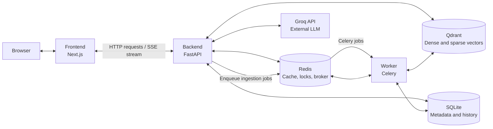
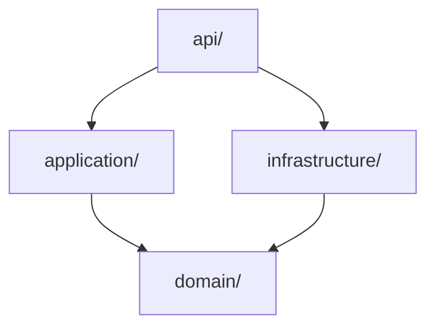
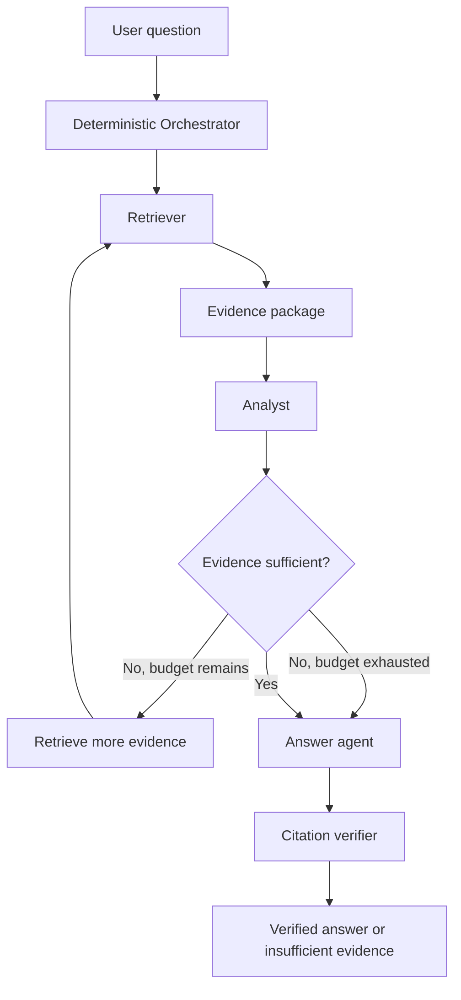

# Architecture

## Table of Contents

- [1. Purpose](#1-purpose)
- [2. System Overview](#2-system-overview)
- [3. Backend Layers](#3-backend-layers)
- [4. Ingestion Pipeline](#4-ingestion-pipeline)
- [5. Agents and the Orchestrator](#5-agents-and-the-orchestrator)
- [6. Citation Verification](#6-citation-verification)
- [7. Caching](#7-caching)
- [8. Key Design Decisions](#8-key-design-decisions)

---

## 1. Purpose

NLP Doc Chat answers questions over a private document corpus. It follows an **evidence-first** approach: every claim in an answer is tied to a specific chunk of a specific document, with page or section provenance.

The system does not return an answer that it cannot cite.

## 2. System Overview

The application runs as a five-service Docker Compose stack. SQLite is used as a local, file-based database, while the Groq API is an external service.

### Services and responsibilities

| Component | Responsibility |
|---|---|
| **Frontend** | Next.js application. It is the only externally reachable application service, proxies chat and upload requests to the backend, and bridges the Server-Sent Events (SSE) stream to the browser. |
| **Backend** | FastAPI application that owns the RAG pipeline, including ingestion orchestration, retrieval, agents, tools, and citation verification. |
| **Worker** | Celery worker that processes asynchronous document-ingestion jobs. It uses the same Docker image as the backend, with a different runtime command. |
| **Qdrant** | Stores dense and sparse vectors together with payload metadata. |
| **Redis** | Provides the exact-response cache, embedding cache, in-flight locks, and Celery message broker. |
| **SQLite** | Stores the document registry, chunk metadata, ingestion job state, citation map, and conversation history. |
| **Groq API** | External LLM provider used by the system. |

### High-level architecture

The worker performs ingestion outside the request-response cycle. The backend submits jobs to the Celery broker in Redis, and the worker processes them asynchronously.

## 3. Backend Layers

The backend follows a strict layered architecture. Dependencies point inward toward the domain layer.

### Layer responsibilities

| Layer | Responsibility |
|---|---|
| `api/` | Transport layer: HTTP handlers, request and response schemas, and dependency-injection wiring. |
| `application/` | Use cases, agents, tools, caching, the ingestion pipeline, and citation handling. |
| `domain/` | Entities, value objects, ports, and domain exceptions. Contains no I/O. |
| `infrastructure/` | Adapters for Qdrant, Redis, SQLite, Groq, parsers, OCR, and the task queue. |
| `core/` | Configuration, logging, tracing, and shared errors. |

### Dependency direction

### Architecture rules

- `domain/` does not import application, API, or infrastructure layers. It has no I/O and uses no framework or library imports beyond the standard library and Pydantic value objects.
- `application/` depends only on `domain/` and the ports defined by the domain layer.
- `infrastructure/` implements the ports defined by the domain layer.
- `api/` wires the application and infrastructure together through dependency providers.

This structure keeps external adapters replaceable. For example, replacing Qdrant with another vector store or Groq with another LLM provider should require changes only in `infrastructure/` and `api/dependencies/providers.py`.

## 4. Ingestion Pipeline

Document ingestion is **asynchronous** and **idempotent**. It runs in the worker rather than in the request cycle.

### Pipeline flow

Each step is implemented as a discrete module under `application/ingestion/steps/` and composed by `pipeline.py`.

### Pipeline steps

1. **Validate** — Check MIME type, file size, page count, encryption, and checksum-based deduplication.
2. **Parse** — Use a parser selected for the file type through a parser factory.
3. **OCR** — Run OCR only when the number of extracted characters per page falls below a configured threshold.
4. **Clean** — Remove headers, footers, repeated boilerplate, and broken hyphenation.
5. **Chunk** — Apply structural chunking first, followed by token-aware splitting when needed. Tables are never split.
6. **Extract tables** — Produce structured JSON containing page, row, column, and bounding-box provenance.
7. **Embed** — Generate dense embeddings with `bge-small` and sparse BM25 representations with FastEmbed.
8. **Index** — Perform an atomic upsert into Qdrant and write the chunk registry to SQLite.

Every step is idempotent. Re-uploading an identical file—identified by a matching checksum—returns the existing document instead of processing it again.

## 5. Agents and the Orchestrator

The **Orchestrator is a deterministic state machine**, not an LLM. It controls:

- The order in which agents are invoked.
- Token, latency, tool-call, and loop budgets.
- Retry and clarification policies.
- The final state transition to `answer_ready` or `insufficient_evidence`.

### 5.1. Retriever

The **Retriever** is responsible for finding evidence. It does not generate answers.

It combines the following components:

| Component | Responsibility |
|---|---|
| **Query Rewriter** | Resolves pronouns, expands acronyms, and preserves exact IDs and quoted phrases. |
| **Metadata Filter** | Converts natural-language constraints into structured filters. Filters are validated server-side against user access permissions. |
| **Semantic Search** | Performs dense-vector search in Qdrant. |
| **Keyword Search** | Performs sparse BM25 search in Qdrant. |
| **Hybrid Fusion** | Combines search rankings using Reciprocal Rank Fusion (RRF), performed natively by Qdrant. |
| **Reranker** | Uses a cross-encoder to rerank the top candidates. |
| **Context Selector** | Uses Maximal Marginal Relevance (MMR), per-document caps, and a token budget to create a compact evidence package. |

### 5.2. Analyst

The **Analyst** reasons over the retrieved evidence and uses tools for tasks that should not be delegated to free-form LLM generation.

| Tool | Responsibility |
|---|---|
| **Calculator** | Performs arithmetic deterministically; calculations are not performed by the LLM. |
| **Table Extractor** | Extracts structured tables from documents. |
| **Document Comparison** | Performs normalized comparisons across documents. |
| **Data Analysis** | Runs pandas operations in a sandbox with an allowlist of permitted operations. |
| **Search / Retrieve More Evidence** | Sends a follow-up query to the Retriever as part of a bounded feedback loop. |

The Analyst emits an explicit **sufficiency verdict**:

- If evidence is missing, it triggers the feedback loop to retrieve more evidence.
- If evidence conflicts, it flags the conflict.
- If the loop budget is exhausted, it passes the insufficiency state to the Answer agent.

### 5.3. Answer

The **Answer** agent produces the final response. It:

- Generates answers only from the supplied evidence package.
- Adds inline citations in the form `[doc_name, p. X]` or `[doc_name, §X]`.
- Uses tables when they make the answer clearer.
- States assumptions and evidence conflicts explicitly.

### Agent workflow

## 6. Citation Verification

After answer generation, a **deterministic citation verifier** checks every citation placeholder against the evidence package.

If a citation cannot be resolved to a real chunk, the answer is repaired or downgraded before it is returned to the user. This verification step is mandatory: it is a core part of the system's evidence-first design.

## 7. Caching

The system uses four cache and coordination mechanisms:

| Layer | Mechanism | Purpose |
|---|---|---|
| **L1 — Exact cache** | Redis | Caches exact requests. The key is a hash of the normalized query, filters, and parameters. |
| **L2 — Semantic cache** | Qdrant | Matches paraphrased queries in a dedicated collection. It uses a strict similarity threshold and prefers a cache miss over an incorrect hit. |
| **L3 — Embedding cache** | Redis | Maps a text hash to its embedding vector. This is safe because embeddings are deterministic. |
| **L4 — In-flight lock** | Redis | Coalesces duplicate concurrent queries so they are handled by a single computation. |

### Cache invalidation

Cache invalidation is **citation-based**. When a cited document is updated or deleted, cached answers that cite that document are evicted.

## 8. Key Design Decisions

The `decisions/` directory contains the rationale behind the main architecture choices:

- Vector store selection: [`decisions/vector-store.md`](decisions/vector-store.md)
- Deterministic orchestrator state machine: [`decisions/orchestrator.md`](decisions/orchestrator.md)
- Dual-layer caching strategy: [`decisions/caching.md`](decisions/caching.md)
- Frontend technology stack: [`decisions/frontend.md`](decisions/frontend.md)
